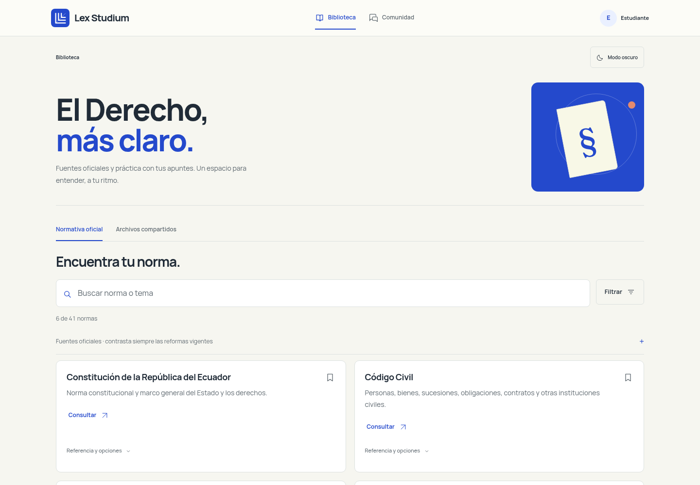
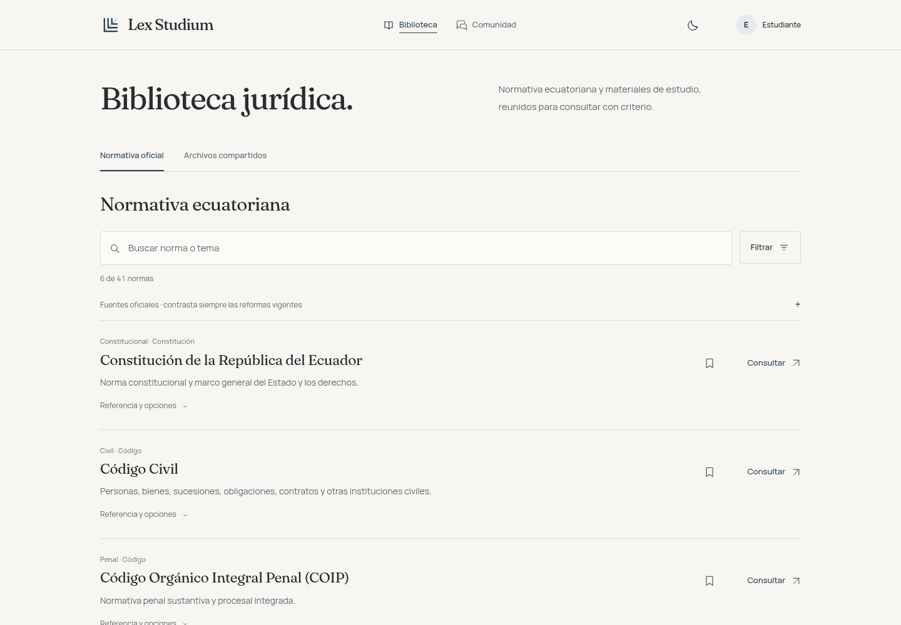
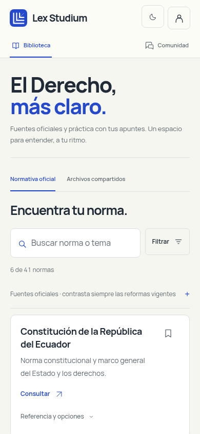
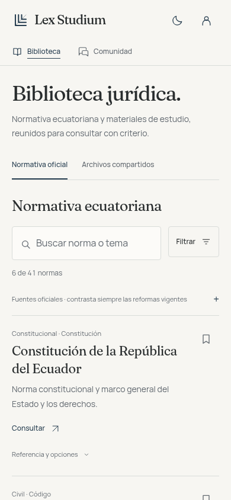

# Lex Studium · revisión editorial sin publicar

Este borrador sustituye la presentación de Foro por una biblioteca universitaria más sobria. Se desarrolla desde `main` en el commit `da9998a`, con los mismos registros y funciones. No se ha fusionado ni desplegado; la web pública conserva su presentación anterior.

## Capturas reales del antes y el después

El antes se capturó desde https://cuentautmach-svg.github.io/lex-studium/. Su HTML coincidía byte a byte con `main` al iniciar la revisión. El después se capturó en Chromium desde la copia local modificada. Son capturas del navegador, sin generación de imágenes, retoques ni datos de catálogo inventados. Los tamaños y el almacenamiento inicial de ambas versiones son equivalentes.

| Vista | Antes | Después |
| --- | --- | --- |
| Escritorio, 1440 × 1000 | [](capturas/antes-escritorio.png) | [](capturas/despues-biblioteca-escritorio.png) |
| Móvil, 390 × 844 | [](capturas/antes-movil.png) | [](capturas/despues-biblioteca-movil.png) |

Más vistas reales: [catálogo de escritorio](capturas/despues-catalogo-escritorio.png), [biblioteca móvil completa](capturas/despues-biblioteca-movil-completa.png), archivos compartidos en [escritorio](capturas/despues-archivos-escritorio.png) y [móvil](capturas/despues-archivos-movil.png), modo oscuro en [escritorio](capturas/despues-oscuro-escritorio.png) y [móvil](capturas/despues-oscuro-movil.png), perfil en [escritorio](capturas/despues-perfil-escritorio.png) y [móvil](capturas/despues-perfil-movil.png).

## Decisiones visuales

- Marfil `#f7f6f2`, texto carbón `#292d2e` y acento azul tinta `#283f51`. El azul de la identidad anterior permanece con menos saturación.
- Fraunces autoalojada, de peso moderado, para títulos; Manrope para lectura y controles. Se conservan las licencias existentes.
- Portada breve, sin ilustración de libros, órbitas ni bloques decorativos. Se eliminó el subtítulo duplicado del catálogo.
- Una columna de normas, separadores finos y superficies abiertas. Cada entrada conserva descripción, clasificación, consulta, favorito y referencias desplegables.
- Filtros nativos que abren una fila propia, sin reposicionamiento negativo. Controles de al menos 44 px e inputs de 16 px en móvil.
- Archivos, comunidad y perfil comparten la misma presentación sobria. El modo oscuro tiene sus propias variables de superficie y texto.

El CSS editable está en `design-proposals/editorial.css`, concatenado después de `progressive.css`. Las alternativas anteriores `?design=archivo` y `?design=orbita` siguen disponibles, pero la revisión y las capturas se centran en Foro, la vista predeterminada. `DESIGN.md` se conserva como documentación histórica de esas propuestas.

## Comprobaciones ejecutadas

`npm run build:design`, `npm run test:content` y `npm run test:editorial` completaron correctamente. El [informe detallado](verificacion.json) registra:

- 41 normas disponibles; búsqueda con y sin tildes, filtros, ampliación de resultados, favoritos persistentes, referencias y estado vacío.
- Pestañas y navegación con teclado; tema y perfil persistentes; manejo de fallo de red de archivos con reintento y acceso alternativo.
- 50 mediciones de disposición en 360, 390, 768, 1024 y 1440 px, con ambos temas: cero desbordamientos o superposiciones detectadas.
- 690 muestras de contraste sobre fondos sólidos, sin fallos detectados. Cero errores JavaScript o de recursos de interfaz.
- Siete comprobaciones por SHA-256 confirman que las materias, normas, fuentes, notas, fechas y motor de evaluación no cambian.

Una revisión visual independiente inspeccionó las comparativas y las superficies secundarias y no encontró defectos materiales en las capturas. El revisor genérico sustituyó al agente de Impeccable: el repositorio contiene sus instrucciones, pero no incluye el cargador ni los agentes ejecutables.

El simulador sigue temporalmente pausado, como en `main`. El catálogo de archivos real estaba vacío al capturarlo: no se añadieron documentos de ejemplo. Los móviles son tamaños de ventana de Chromium, sin prueba en teléfono físico; el contraste medido no constituye una certificación completa de accesibilidad. No se revalidó la vigencia de las normas externas.

## Reproducir la revisión

Desde la raíz del repositorio, servir los archivos según el flujo de desarrollo existente:

```sh
python -m http.server 4174 --bind 127.0.0.1
```

Abrir `http://127.0.0.1:4174/`. Para las comprobaciones, con Node 24 y las dependencias instaladas:

```sh
npm run build:design
npm run test:content
BASE_URL=http://127.0.0.1:4174 npm run test:editorial
```

El runner guarda las capturas y el informe en `artifacts/editorial/`. `CAPTURE_BEFORE=1` captura también el sitio público; `OUTPUT_DIR` cambia la carpeta. Solo en entornos de QA cuyo proxy presenta certificados propios puede indicarse `QA_IGNORE_HTTPS_ERRORS=1`; esa opción no cambia la aplicación. En esta máquina se utilizó Chromium de sistema y Playwright Core 1.62.0 preinstalado, pues la instalación de la versión fijada 1.62.1 no se completó. No se alteró el lockfile.
