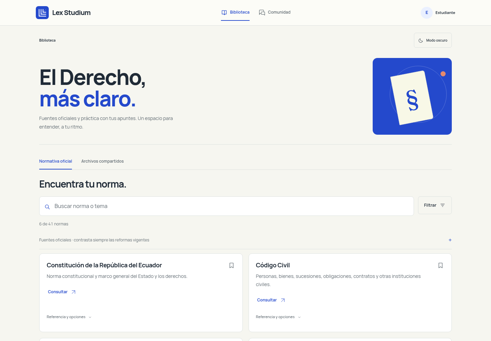
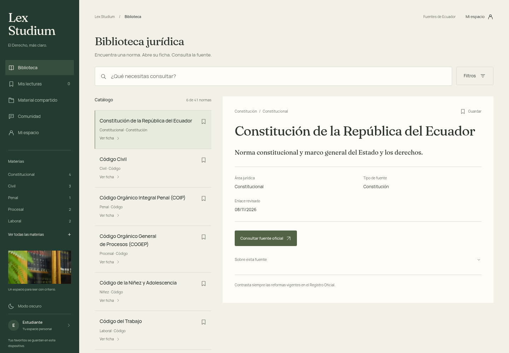
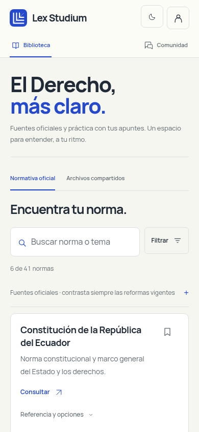
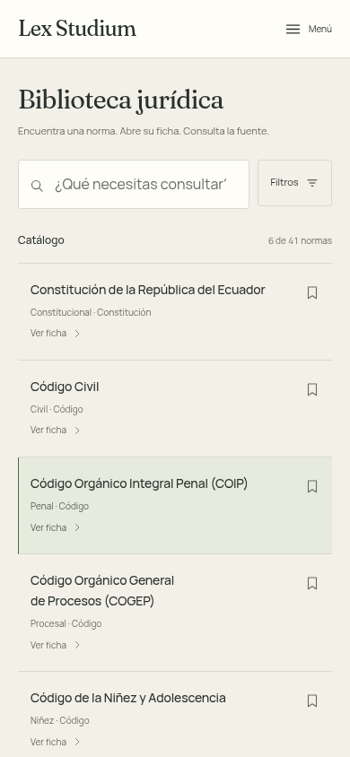
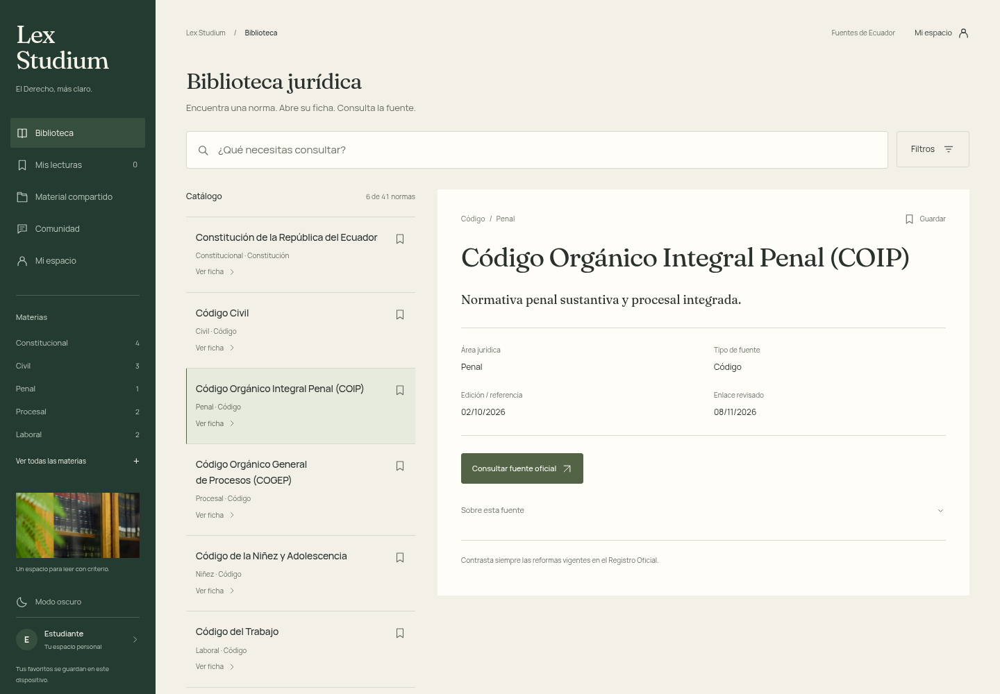
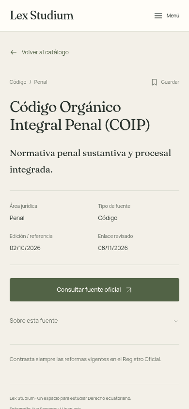

# Lex Studium · sala de consulta

Borrador de una interfaz completamente reorganizada. La web publicada y `main` permanecen intactos. Esta versión utiliza los mismos registros, referencias y almacenamiento local, con un recorrido de consulta nuevo.

## Capturas reales

El antes corresponde a la web pública, cuyo HTML coincidía con `main` (`da9998a`) al capturarlo. El después se capturó en Chromium desde la copia local modificada. Las comparativas usan 1440 × 1000 y 390 × 844, sin datos inventados ni retoques.

| Vista | Antes publicado | Nueva sala de consulta |
| --- | --- | --- |
| Escritorio |  |  |
| Móvil |  |  |

La [propuesta editorial anterior](capturas/propuesta-anterior-escritorio.png) se conserva para comprobar que esta revisión sustituye su composición, además de cambiar el aspecto.

| Seleccionar | Leer |
| --- | --- |
|  |  |

Otras capturas: [menú móvil](capturas/despues-menu-movil.png), [catálogo móvil completo](capturas/despues-biblioteca-movil-completa.png), [lecturas guardadas vacías](capturas/despues-lecturas-vacias-escritorio.png), modo oscuro en [escritorio](capturas/despues-oscuro-escritorio.png) y [móvil](capturas/despues-oscuro-movil.png), material compartido en [escritorio](capturas/despues-archivos-escritorio.png) y [móvil](capturas/despues-archivos-movil.png), perfil en [escritorio](capturas/despues-perfil-escritorio.png) y [móvil](capturas/despues-perfil-movil.png).

## Una arquitectura diferente

1. **Índice institucional:** marca tipográfica, navegación estable y materias jurídicas con conteos derivados de las normas reales. Mis lecturas y Material compartido tienen entradas propias; perfil y apariencia permanecen accesibles.
2. **Catálogo de selección:** títulos compactos, área, tipo y favoritos, sin repetir descripciones extensas en cada entrada. Búsqueda y filtros se combinan con el índice de materias.
3. **Ficha bibliográfica:** la selección muestra título, resumen, datos, revisión, edición disponible, nota de vigencia y enlaces oficiales. Se distingue seleccionar una fuente de abrir su web externa.
4. **Lectura móvil:** el catálogo ocupa el ancho disponible. Abrir una norma lleva a una ficha completa con Volver al catálogo, Escape, historial y restauración de foco/posición. La navegación y las materias se abren en un cajón accesible.

Se eliminaron la portada promocional, la ilustración decorativa, las pestañas superiores y la rejilla de tarjetas. La aplicación abre directamente una ficha real de la Constitución junto al catálogo en escritorio.

## Sistema visual del borrador

- Papel cálido `#f3f0e8`, página de lectura `#fffdf8`, texto `#29322d`, acento oliva `#526346` e índice institucional `#233b30`.
- Fraunces moderada para la marca y los títulos de lectura; Manrope para la navegación y el catálogo. Fuentes autoalojadas, licencias existentes conservadas.
- Composición de 224 px de índice y aproximadamente 330 px de catálogo en escritorio; el espacio restante pertenece a la ficha. Por debajo de 1100 px el índice se convierte en cajón; hasta 760 px el catálogo y la ficha son vistas separadas.
- Superficies planas, filetes finos, controles de al menos 44 px e inputs móviles de 16 px. Se conservan foco visible y movimiento reducido. Modo oscuro con sus propias superficies y colores de texto.
- Una fotografía ambiental real de Ilya Semenov, bajo Unsplash License, aporta contexto al índice. No se atribuye esa biblioteca a Lex Studium. La foto y su procedencia se encuentran en `assets/photography/`, fuera del catálogo educativo de materiales.

## Funciones y comprobación

Build, invariantes del contenido y pruebas de interfaz completadas. El [informe detallado](verificacion.json) registra 13 capturas finales, 68 comprobaciones de disposición en cinco anchos y ambos temas, y 902 muestras de contraste sobre fondos sólidos, sin fallos detectados. No se detectaron errores JavaScript ni recursos de interfaz fallidos, incluida la fotografía.

Se comprobaron:

- Las 41 normas, ampliación progresiva, búsqueda sin tildes, combinación de palabras, filtros y estados vacíos.
- Conteos de materias reales: Civil 3, Constitucional 4, Tecnología 3; tipo Código 14.
- Selección y correspondencia de la ficha con el índice original y sus referencias, PDF y fuente oficial.
- Guardar, quitar el último favorito, persistencia y navegación a Mis lecturas.
- Menú por teclado, foco, Escape, historial móvil, regreso al catálogo, cambio de tamaño y navegación entre biblioteca y comunidad.
- Perfil y apariencia persistentes; carga de los materiales reales y alternativa de recuperación al fallar la red.
- Siete comprobaciones SHA-256 confirman que materias, normas, fuentes, fechas, notas y motor de evaluación permanecen intactos. El simulador sigue pausado.

Una revisión visual independiente comparó las capturas con la web publicada y con la propuesta anterior. Confirmó el cambio de estructura y no encontró defectos visuales materiales. Se utilizó un revisor genérico porque el cargador y los agentes ejecutables de Impeccable no están incluidos en este repositorio.

Los móviles son tamaños de ventana de Chromium; no se probó en teléfono físico. El catálogo real de materiales estaba vacío y se capturó así. La medición de contraste se limita a fondos sólidos y no equivale a una certificación completa de accesibilidad. No se revalidó la vigencia jurídica de las fuentes.

## Reproducir

Con el servidor estático iniciado, ejecutar:

```sh
npm run build:design
npm run test:content
BASE_URL=http://127.0.0.1:4174 npm run test:campus
```

En esta máquina se utilizó Chromium y Playwright Core 1.62.0 preinstalado; la versión fijada 1.62.1 no pudo instalarse y el lockfile se conservó. `QA_IGNORE_HTTPS_ERRORS=1` se utilizó únicamente para que el navegador de pruebas pudiera pasar por el proxy con certificado propio, sin modificar la aplicación.
